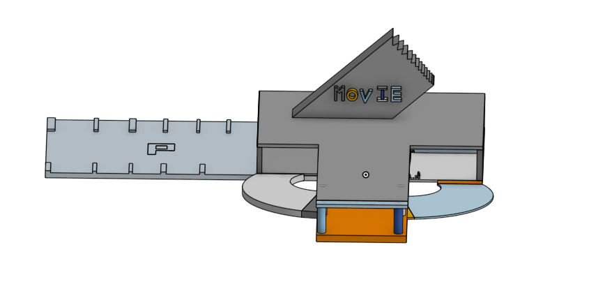
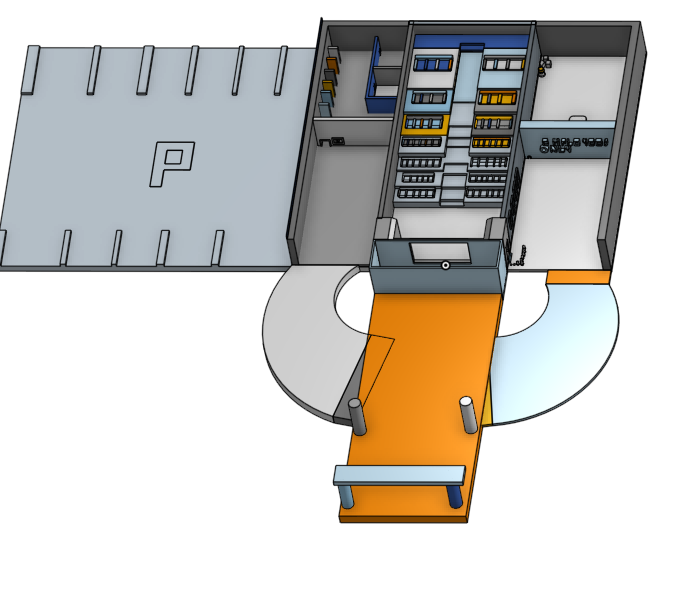

# doom
NOW YOU CAN SAY THAT YOU OWN A PRIVATE THEATER !!

# what it is
So it's a theater a very well detailed one , made using rasberry pi and 3.5inch display.

# what does it do:
Besides from your private theater it has uses like:
- watch movies
- decoration
- prop 

# what is in the repo
this repo includes STL files so that you could print it for you self (refer to warnings before printing) , it also includes editable files so that you can change it according to your preference.

# tech stack
- onshape
- pi os

# warnings
this model is not optimized for printing  (hence will use a lot filament) . so it is recommended to shrink the thickness of walls and the sign . [ even though i have hollowed everything i could ]

# Bill of Materials (BOM)

| Item | Qty | Supplier | Cost/item | Total Cost | Link |
|---|---:|---|---:|---:|---|
| Raspberry Pi 3B+ | 1 | Silver Line Electronics | $40.00 | $40.00 | [Link](https://www.silverlineelectronics.in/collections/the-raspberry-pi/products/raspberry-pi-3-model-bplus-silverline-india?_pos=1&_sid=ecd9ec080&_ss=r&src=raspberrypi) |
| 3D Print (when optimized) | 1 | JLC3DP | $135.00 | $135.00 | [Link](https://jlc3dp.com/) |
| Screen | 1 | Robu | $20.89 | $20.89 | [Link](https://robu.in/product/waveshare-3-5inch-resistive-touch-display-c-for-raspberry-pi-480x320-125mhz-high-speed-spi/) |
| Estimated Shipping | 1 | — | — | $12.00 | — |

## Total Estimated Cost

**$207.89**
  
